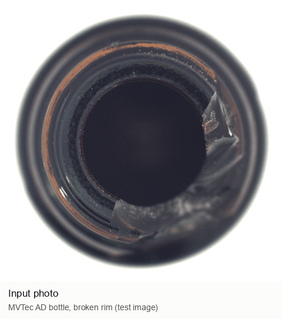
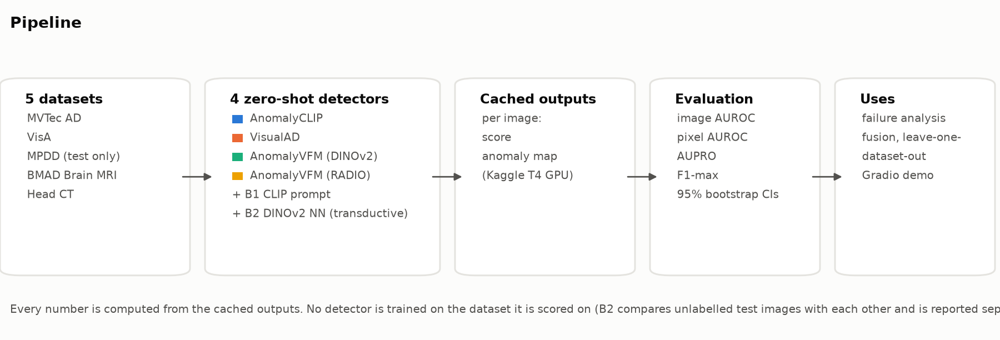
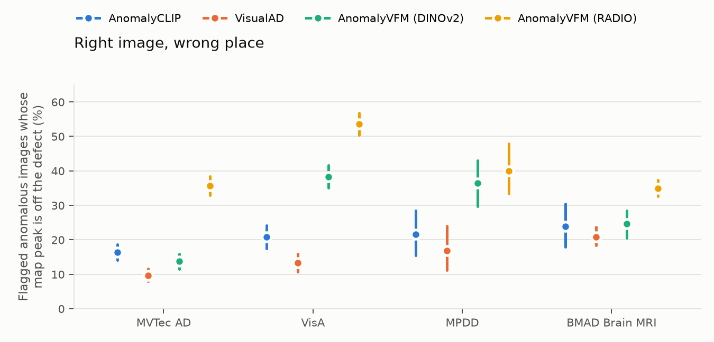
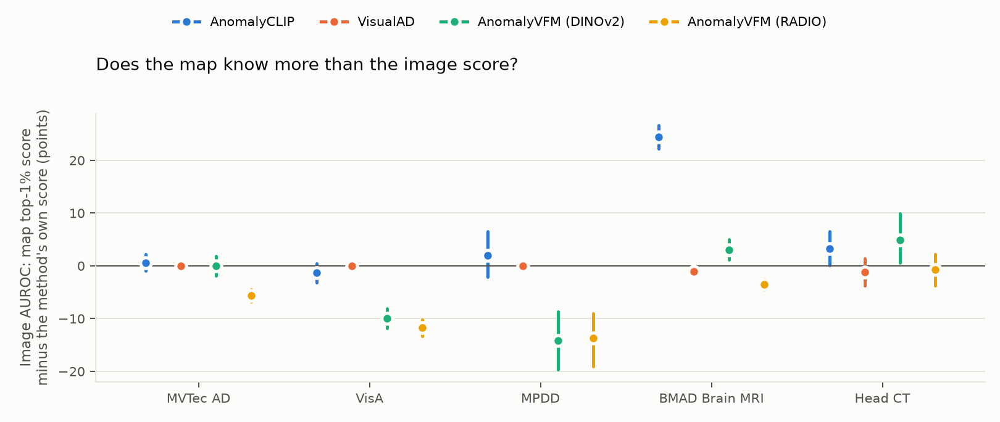
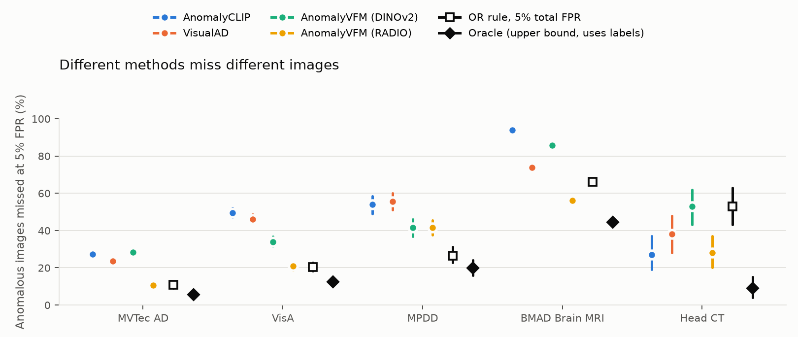
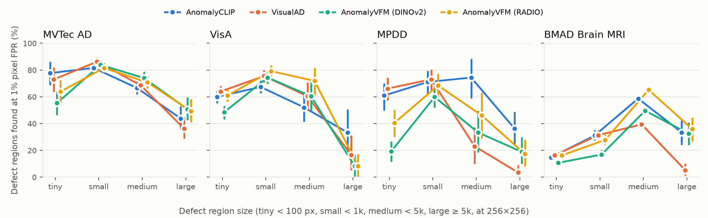
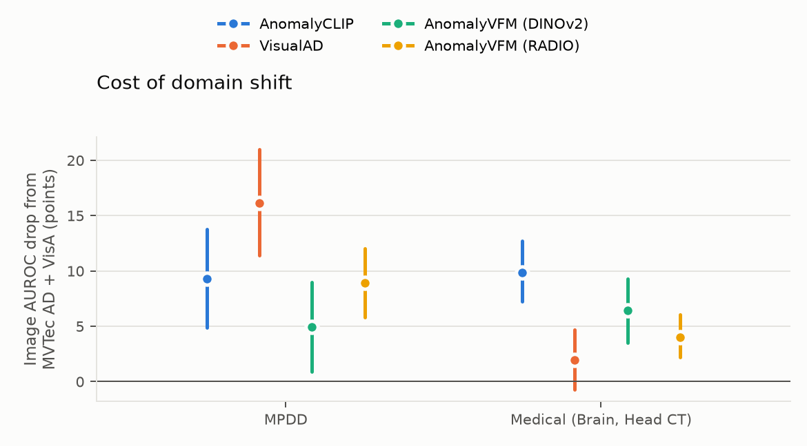
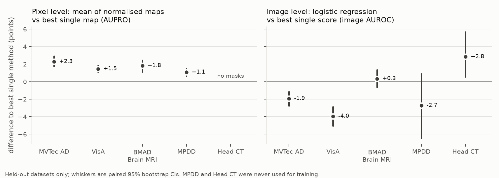

# Zero-Shot Anomaly Detection Stress Test

Zero-shot anomaly detectors promise to find defects on objects they have never seen. Papers report them one
method at a time, as dataset averages. This project runs **one detector from each of three families** through
the **same evaluation harness** on industrial and medical images, and asks where each one fails, whether they fail
on different images, and whether combining them helps on datasets they were never tuned on.

**Live demo:** [huggingface.co/spaces/addy0606/zsad](https://huggingface.co/spaces/addy0606/zsad). Upload a photo
and see all four detectors' anomaly maps, their fused map, and a per-method verdict (about 10–20 s per photo).



*Frames from the live Space (`python report/demo_gif.py`). Image: MVTec AD, CC BY-NC-SA 4.0.*

## What I found

| Question | Answer (95% bootstrap CIs; details in [`analysis/FINDINGS.md`](analysis/FINDINGS.md) and [`results/fusion.md`](results/fusion.md)) |
|---|---|
| Which defects does each family miss? | **Tiny defects** split the families: AnomalyVFM DINOv2 finds 19.2% [12.2, 26.2] of tiny MPDD defect regions, the two CLIP-backbone methods 60.9–66.2%. **Missing and mismatched parts** (VisA pcb2, MPDD brackets) are at chance for every method. |
| How much does performance drop off the standard benchmarks? | It depends on the family. VisualAD loses 16.1 [11.4, 21.0] image-AUROC points on MPDD but only 2.0 [−0.7, 4.7] on medical images; AnomalyCLIP loses 9.8 [7.2, 12.7] on medical images. |
| Do they fail on different images, and does fusion help? | They miss different images: an oracle that picks the right method per image would roughly halve the misses on industrial data (MVTec AD: 10.5% → 5.5% at 5% false alarms). But no fused **image score** beats the best single detector (AnomalyVFM RADIO) on the industrial datasets. Fusing the **anomaly maps** does help: the plain average of the four normalised maps beats the best single map on all four held-out datasets (AUPRO +1.1 to +2.3 points). |
| Do image scores and maps agree? | Not always. Among anomalies AnomalyVFM RADIO correctly flags, its map's peak lies off the defect for 36.0–53.7% of industrial images (VisualAD: 10.7–17.3%). The reverse also happens: AnomalyCLIP's image score is near chance on brain MRI (60.7), but scoring the same images from its own map gives 85.1. |

## Pipeline



| Family | Method | How it detects | Trained on (never the test dataset) |
|---|---|---|---|
| CLIP-based | [AnomalyCLIP](https://github.com/zqhang/AnomalyCLIP) (ICLR 2024) | learned "normal" / "abnormal" text prompts matched to CLIP patch features | MVTec AD (VisA when testing on MVTec AD) |
| Language-free | [VisualAD](https://github.com/7HHHHH/VisualAD) (CVPR 2026) | same frozen CLIP encoder, learned visual tokens, no text | VisA (MVTec AD when testing on VisA; trained by me) |
| Vision foundation model | [AnomalyVFM](https://github.com/MaticFuc/AnomalyVFM) (CVPR 2026), DINOv2 | foundation-model features + decoder | synthetic anomalies only |
| Vision foundation model (extra) | AnomalyVFM, RADIO backbone | same, RADIO backbone | synthetic anomalies only |
| Baseline B1 | plain CLIP prompts | "a photo of a flawless {object}" vs "a photo of a damaged {object}", several templates | nothing |
| Baseline B2 | DINOv2 mutual nearest neighbour | compares each test image with the *other unlabelled test images* (transductive, so reported separately) | nothing |

Datasets: MVTec AD (1,725 test images), VisA (2,162), MPDD (458; harder metal parts, used for testing only),
BMAD Brain MRI (3,715) and Head CT (200, image labels only). Every map is evaluated at 256×256.

## Main results

Image AUROC (detection): mean over categories, in %, with 95% bootstrap CIs over images (1,000 resamples).

<!-- table: results/benchmark.md#Image AUROC -->
| Method | MVTec AD | VisA | MPDD | BMAD Brain MRI | Head CT |
|---|---|---|---|---|---|
| AnomalyCLIP | 91.6 [90.0, 93.0] | 82.0 [80.3, 83.7] | 77.5 [73.0, 81.7] | 60.7 [58.2, 63.2] | 93.1 [89.1, 96.5] |
| VisualAD | 92.2 [90.9, 93.5] | 83.1 [81.5, 84.7] | 71.5 [66.6, 76.5] | 80.8 [78.9, 82.8] | 90.6 [86.1, 94.5] |
| AnomalyVFM (DINOv2) | 87.4 [85.6, 89.3] | 89.3 [88.0, 90.5] | 83.4 [79.2, 86.9] | 75.6 [73.4, 77.8] | 88.2 [83.3, 92.5] |
| AnomalyVFM (RADIO) | 96.4 [95.3, 97.5] | 92.9 [91.7, 93.9] | 85.7 [82.6, 88.9] | 87.3 [85.7, 88.7] | 94.0 [90.4, 97.1] |
| B1 CLIP prompt | 86.6 [84.5, 88.4] | 77.1 [75.4, 78.9] | 70.8 [65.7, 76.0] | 65.0 [62.7, 67.5] | 85.4 [79.9, 90.0] |
| B2 DINOv2 mutual NN | 92.5 [91.1, 94.0] | 82.7 [81.0, 84.4] | 64.8 [59.9, 70.1] | 74.4 [72.1, 76.5] | 61.1 [53.9, 68.3] |
<!-- /table -->

AUPRO at FPR ≤ 0.3 (localisation; rewards finding every defect region, not just large ones):

<!-- table: results/benchmark.md#AUPRO (FPR ≤ 0.3) -->
| Method | MVTec AD | VisA | MPDD | BMAD Brain MRI | Head CT |
|---|---|---|---|---|---|
| AnomalyCLIP | 85.1 [83.9, 86.2] | 86.9 [85.7, 88.1] | 89.4 [88.1, 90.6] | 79.7 [78.8, 80.6] | — |
| VisualAD | 87.7 [86.5, 88.8] | 89.8 [88.7, 90.8] | 92.8 [92.1, 93.6] | 79.9 [79.1, 80.7] | — |
| AnomalyVFM (DINOv2) | 85.3 [84.0, 86.7] | 82.8 [81.2, 84.3] | 88.1 [87.0, 89.2] | 60.8 [59.4, 62.2] | — |
| AnomalyVFM (RADIO) | 87.2 [85.9, 88.3] | 88.3 [87.0, 89.6] | 88.4 [87.0, 89.7] | 74.4 [73.2, 75.4] | — |
| B1 CLIP prompt | 8.0 [7.1, 8.9] | 15.5 [14.0, 17.0] | 16.9 [14.5, 19.7] | 11.4 [10.8, 12.0] | — |
| B2 DINOv2 mutual NN | 90.6 [89.9, 91.4] | 83.0 [81.7, 84.4] | 86.1 [84.6, 87.7] | 78.7 [77.8, 79.5] | — |
<!-- /table -->

Pixel AUROC, F1-max and per-category numbers: [`results/benchmark.md`](results/benchmark.md) and
[`results/benchmark.csv`](results/benchmark.csv). Inference cost on one Kaggle T4:

<!-- table: results/benchmark.md#Cost (inference only) -->
| Method | Images timed | Seconds / image | Peak GPU memory (MB) | GPU |
|---|---|---|---|---|
| AnomalyCLIP | 8260 | 0.554 | 2036 | Tesla T4 |
| VisualAD | 8260 | 0.386 | 1876 | Tesla T4 |
| B1 CLIP prompt | 8260 | 0.147 | 1707 | Tesla T4 |
| AnomalyVFM (DINOv2) | 8260 | 0.202 | 1877 | Tesla T4 |
| AnomalyVFM (RADIO) | 8260 | 0.216 | 1938 | Tesla T4 |
| B2 DINOv2 mutual NN | 8260 | 0.107 | 2573 | Tesla T4 |
<!-- /table -->

### Do my numbers match the papers?

Before trusting the harness, each method was run in its paper's own setting on MVTec AD and VisA and compared with
the published numbers. Image AUROC / pixel AUROC / AUPRO, in %:

| Method | Dataset | This repo | Published | Image AUROC difference |
|---|---|---|---|---|
| AnomalyCLIP (layer 24, official setting) | MVTec AD | 91.6 / 91.1 / 85.1 | 91.5 / 91.1 / 81.4 | +0.1 |
| AnomalyCLIP (layer 24, official setting) | VisA | 82.0 / 95.5 / 86.9 | 82.1 / 95.5 / 87.0 | −0.1 |
| AnomalyVFM (DINOv2) | MVTec AD | 87.4 / 91.4 / 85.3 | 87.4 / 91.6 / 84.5 | 0.0 |
| AnomalyVFM (DINOv2) | VisA | 89.3 / 94.2 / 82.8 | 89.3 / 94.5 / 84.5 | 0.0 |
| AnomalyVFM (RADIO) | MVTec AD | 96.4 / 91.3 / 87.2 | 96.4 / 92.0 / 87.6 | 0.0 |
| AnomalyVFM (RADIO) | VisA | 92.9 / 94.9 / 88.3 | 92.9 / 95.8 / 90.5 | 0.0 |
| VisualAD (authors' VisA-trained checkpoint) | MVTec AD | 92.2 / 90.8 / 87.7 | 92.2 / 90.8 / 87.5 | 0.0 |
| VisualAD (my MVTec AD-trained checkpoint) | VisA | 83.1 / 95.3 / 89.8 | 84.7 / 95.8 / 91.0 | −1.6 |

Every image AUROC is within 2 points of the paper. The three larger pixel-level gaps:

- **AnomalyCLIP AUPRO on MVTec AD (+3.7):** the paper's AUPRO function (200 fixed thresholds, then a rescaled FPR
  axis) gives 81.2 on *my* maps, matching its published 81.4; the exact AUPRO used here gives 85.1. So the gap is
  the metric implementation, not the model, and published AUPRO values from different papers aren't directly
  comparable. AnomalyCLIP also matches only when run with layer 24 alone, as in the authors' test script (the code's
  default of four layers gives lower pixel scores).
- **AnomalyVFM AUPRO on VisA (−1.7 DINOv2, −2.2 RADIO):** probably the same kind of cause (the paper uses a
  different, binned metric library), but not verified.
- **VisualAD on VisA (−1.6 image AUROC):** the MVTec AD-trained checkpoint isn't released, so I trained it with the
  authors' script at batch size 4 instead of 8, which ran out of memory on a 16 GB GPU.

## Failure analysis

Five findings, each backed by a figure with 95% bootstrap CIs. Tables and exact numbers:
[`analysis/FINDINGS.md`](analysis/FINDINGS.md).

**1. Right image, wrong place.** Among anomalous images a method correctly flags (at 5% false alarms), how often
its map's highest point lies off the defect. AnomalyVFM RADIO, the best image-level detector, points at the wrong
spot in 36–54% of industrial images; VisualAD in 11–17%.



**2. Does the map know more than the image score?** Image AUROC when each image is scored from the top 1% of its
own map, minus the method's own image score. AnomalyCLIP's map finds brain tumours its image score misses
(+24.4 points); AnomalyVFM's own score is better than its map (down to about −14 on MPDD).



**3. Different methods miss different images.** Anomalous images missed at 5% false alarms by each method, by an
"OR rule" (flag if any method fires, thresholds lowered so the total false-alarm rate stays at 5%) and by an oracle
that picks the right method per image (uses labels: an upper bound for fusion). The gap between the best method and
the oracle is large, but the label-free OR rule only closes it on MPDD.



**4. Tiny defects are a blind spot, unequally.** Share of ground-truth defect regions found (at least half their
pixels above the method's 1%-false-alarm pixel threshold), by region size. AnomalyVFM DINOv2 finds only 19% of tiny
MPDD defects. Large regions score lower partly because of the half-of-the-region rule.



**5. Domain shift hits the families differently.** Image AUROC drop from the standard benchmarks (MVTec AD and VisA)
to MPDD and to the medical datasets. VisualAD drops 16 points on MPDD but about 2 on medical images; AnomalyCLIP
drops about 10 on medical images.



## Fusion

Fusion heads are trained **leave-one-dataset-out** over MVTec AD, VisA and BMAD Brain MRI, with hyperparameters
chosen by an inner leave-one-dataset-out on the training datasets. MPDD and Head CT are never used for training.
Every number below is on a held-out dataset.



Pixel-level fusion, AUPRO (in brackets after a fused head: its paired difference to the best single map):

<!-- table: results/fusion.md#AUPRO (FPR ≤ 0.3) (pixel-level fusion) -->
| Head | MVTec AD | VisA | BMAD Brain MRI | MPDD |
|---|---|---|---|---|
| Best single map (chosen by training AUPRO) | 87.7 [86.5, 88.8] — visualad | 89.8 [88.7, 90.8] — visualad | 79.9 [79.1, 80.7] — visualad | 92.8 [92.1, 93.6] — visualad |
| Mean of normalised maps | 89.9 [88.9, 91.0] (+2.3 [+1.7, +2.9]) | 91.2 [90.3, 92.1] (+1.5 [+1.1, +1.9]) | 81.8 [80.7, 82.7] (+1.8 [+1.1, +2.5]) | 93.9 [93.3, 94.5] (+1.1 [+0.6, +1.5]) |
| Logistic regression on maps | 90.0 [88.9, 91.0] (+2.3 [+1.8, +2.9]) | 91.3 [90.4, 92.2] (+1.5 [+1.1, +1.9]) | 81.9 [80.8, 82.8] (+1.9 [+1.2, +2.5]) | 93.9 [93.3, 94.5] (+1.1 [+0.6, +1.5]) |
<!-- /table -->

Logistic regression learns near-equal weights for the four maps and matches the plain average, so the gain comes
from averaging, not from learning. At image level, fusion only helps on Head CT (+2.8 [+0.5, +5.7]). The full
ablation, with boosted trees, miss rates at 5% false alarms and the oracle upper bound, is in
[`results/fusion.md`](results/fusion.md).

## Reproduce

### What the cache is, and why it exists

Producing the results has two very different halves:

1. **Running the detectors** (expensive): each method processes every test image on a GPU and writes down, per
   image, its anomaly score and anomaly map. This took about 3.7 hours of GPU model time on Kaggle, needs the datasets (several GB) and
   each method's weights.
2. **Turning those outputs into results** (cheap): AUROC, AUPRO, bootstrap confidence intervals, the failure analysis,
   the fusion experiments, every table and figure. This needs only the per-image numbers from step 1.

The **cache** is the saved output of step 1: per-image scores, metric files, each run's settings, and compact
per-image summaries of the anomaly maps (pixel-score histograms, enough to compute the pixel metrics and their
CIs). It contains no images, no anomaly maps and no model weights. It is about 130 MB, published at
[huggingface.co/datasets/addy0606/zsad-stress-test-cache](https://huggingface.co/datasets/addy0606/zsad-stress-test-cache).

With it, anyone can redo step 2 and check every number in this README without a GPU, without downloading the
datasets, and without a Kaggle account. Because the bootstrap uses fixed seeds, the rebuilt files are identical to
the committed ones, which `git status` confirms. This was tested from a fresh clone.

### Commands

```bash
git clone https://github.com/Addy0606/zsad-stress-test && cd zsad-stress-test
python -m venv .venv && source .venv/bin/activate     # Windows: .venv\Scripts\activate
pip install -r requirements-reproduce.txt
python scripts/fetch_cache.py                         # download the cached outputs into outputs/kaggle/
python scripts/reproduce.py                           # rebuild every table and figure (~1 h on a laptop CPU)
git status                                            # nothing changed: the rebuilt files match the committed ones
```

`scripts/reproduce.py` runs, in order: `eval/make_tables.py` (main tables), `analysis/image_level.py`,
`analysis/region_level.py` and `analysis/figures.py` (failure analysis), `fusion/image_fusion.py` and
`fusion/report.py` (fusion), `app/build_reference.py` (the demo's reference scores), then `report/figures.py` and
`report/readme_tables.py` (this README's figures and tables). Each can also be run on its own.

**Running the detectors from scratch.** This is the expensive part: 3.7 hours of model time on a T4 for all six
methods on all 8,260 test images (from the cost table), run as Kaggle jobs.

```bash
pip install --no-cache-dir torch==2.8.0 torchvision==0.23.0 --index-url https://download.pytorch.org/whl/cu128
pip install --no-cache-dir -r requirements.txt
python scripts/setup_third_party.py      # clone the method repos at pinned commits, download weights
python -m pytest                         # loaders, metrics, bootstrap, fusion split (no leakage)
python eval/run_benchmark.py --method anomalyvfm_radio --dataset mvtec --limit 20   # resumable per image
python scripts/kaggle_submit.py --help   # how the full benchmark ran on Kaggle
```

[`configs/bench_sources.yaml`](configs/bench_sources.yaml) lists the run behind every number; each run folder stores
its resolved config and git commit.

## Repository layout

| Folder | Contents |
|---|---|
| `data/` | dataset loaders behind one interface (`data/base.py`) |
| `methods/` | thin wrappers around each detector behind one interface (`methods/base.py`) |
| `eval/` | metrics (image and pixel AUROC, AUPRO, F1-max), benchmark runner, bootstrap CIs, tables |
| `analysis/` | failure analysis: findings, figures and their CSVs |
| `fusion/` | leave-one-dataset-out splits, train-only normaliser, image- and pixel-level fusion |
| `app/` | the Gradio demo (`scripts/deploy_space.py` publishes it) |
| `report/` | the README's figures and demo GIF, and the scripts that make them |
| `configs/` | one YAML per dataset and method; `bench_sources.yaml` maps every result to its run |

## Limitations

- **One run per method.** CIs cover image sampling, not training randomness. VisualAD's MVTec AD checkpoint (used
  only for VisA) was trained once, at a reduced batch size of 4.
- **Few fusion training sets.** Each fold trains on two datasets, so hyperparameters are chosen on one-vs-one splits.
- **Thin medical coverage:** two datasets, only one with masks; Head CT has 200 images, so its CIs are wide.
- **The demo's verdicts** compare a photo with normal MPDD metal parts. For very different objects, read the maps
  rather than the verdict. Two phone photos (a chipped and an intact mug) behaved sensibly, but that is an
  illustration, not a measurement.

## Credits and licences

Method code is **not copied** into this repo; it is cloned into `third_party/` at pinned commits:
[AnomalyCLIP](https://github.com/zqhang/AnomalyCLIP) (MIT), [AnomalyVFM](https://github.com/MaticFuc/AnomalyVFM)
(no licence file; RADIO weights under NVIDIA's non-commercial licence) and [VisualAD](https://github.com/7HHHHH/VisualAD)
(no licence file). For the two repos without a licence, code and weights are downloaded from the authors at run
time and never redistributed.

| Dataset | Test images | Pixel masks | Licence |
|---|---|---|---|
| MVTec AD (Bergmann et al.) | 1,725 | yes | CC BY-NC-SA 4.0 |
| VisA (Zou et al.) | 2,162 | yes | CC BY 4.0 |
| MPDD (Jezek et al.) | 458 | yes | CC BY-NC-SA 4.0 |
| BMAD Brain MRI (Bao et al.; BraTS 2021 slices) | 3,715 | yes | CC BY-NC-SA 4.0 (BMAD); BraTS terms |
| Head CT hemorrhage (Kitamura, Kaggle) | 200 | no | CC0 |

The cached outputs are published under CC BY-NC-SA 4.0, following the strictest source licence.
