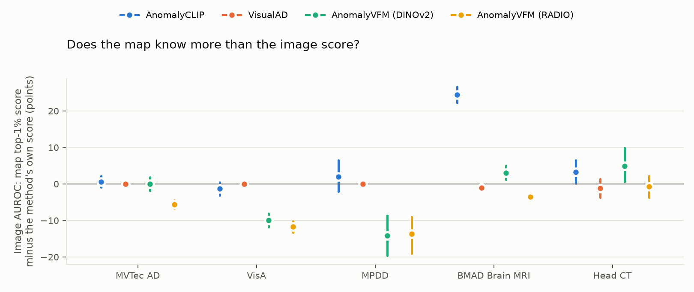
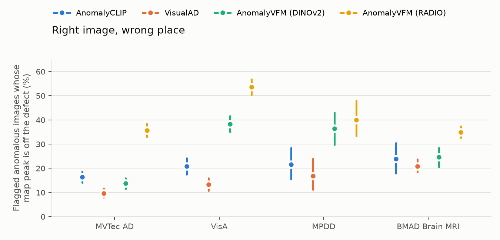
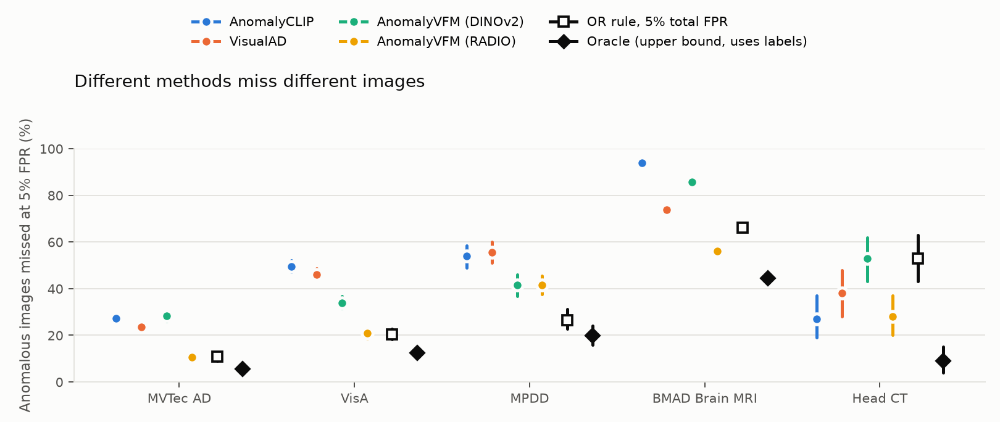
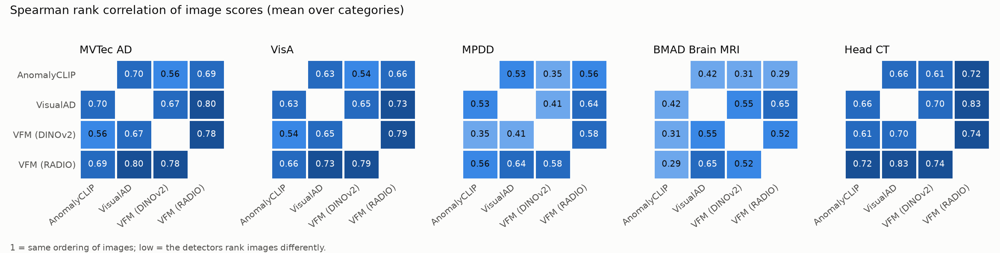
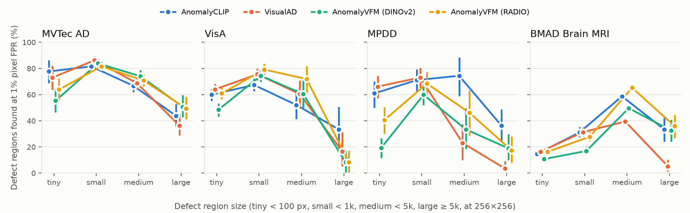
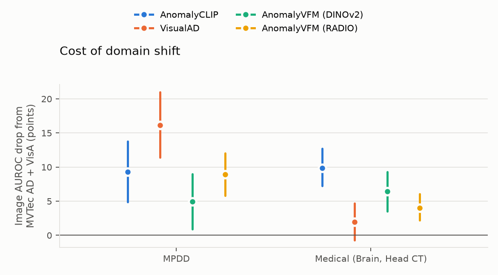

# Phase 5 findings: where zero-shot anomaly detectors fail

Six findings from the 30 benchmark runs (4 single-image detectors + 2 baselines × 5 datasets).
Every number below is copied from a CSV in `analysis/results/`, produced by the scripts named in each section.
Brackets are 95% percentile-bootstrap CIs (1,000 resamples of images, stratified by category and label).
All rates use the common 256×256 evaluation maps.

Methods: **AnomalyCLIP** (CLIP + learned text prompts), **VisualAD** (same frozen CLIP backbone, learned visual
tokens instead of text), **AnomalyVFM DINOv2 / RADIO** (vision foundation model + a decoder trained on synthetic
anomalies). Baselines B1 (plain CLIP prompts) and B2 (transductive DINOv2 nearest neighbour) are shown only where useful.

Reproduce: `python analysis/image_level.py`, `python analysis/region_level.py`, `python analysis/figures.py`,
`python analysis/rank_correlation.py`, `python analysis/gallery_summary.py`
(the per-region and map-score tables come from the Kaggle CPU jobs `analysis/regions.py` and `analysis/map_scores.py`).

---

## 1. AnomalyCLIP's map finds brain tumours that its image score misses (RQ4)

Each method outputs an image score *and* an anomaly map. Scoring each image instead from its own map
(mean of the map's top 1% of pixels) and comparing on the same resampled images (paired bootstrap):

| Method | Dataset | Own image score | Map top-1% score | Difference |
|---|---|---|---|---|
| AnomalyCLIP | BMAD Brain MRI | 60.7 [58.2, 63.2] | **85.1 [83.8, 86.4]** | **+24.4 [+22.2, +26.6]** |
| AnomalyVFM RADIO (best method) | BMAD Brain MRI | 87.3 | 83.7 | −3.6 [−4.6, −2.5] |
| AnomalyVFM RADIO | VisA | 92.9 | 81.1 | −11.8 [−13.3, −10.2] |
| AnomalyVFM RADIO | MPDD | 85.7 | 72.0 | −13.7 [−19.1, −9.0] |
| AnomalyVFM DINOv2 | MPDD | 83.4 | 69.3 | −14.1 [−19.7, −8.7] |
| VisualAD (sanity check) | MVTec AD / VisA / MPDD | 92.2 / 83.1 / 71.5 | same | 0.0 (its image score *is* the top-1% map mean) |

- On Brain MRI, AnomalyCLIP's map localises tumours well (pixel AUROC 96.5) but its image score, which comes
  from the global CLIP embedding compared with the text prompts, is close to chance. Reading the image score
  off the map instead lifts it by 24 points, to within ~2 points of the best method.
- The disagreement runs both ways. For AnomalyVFM the image score (a separate prediction head) is far better than
  its own map on industrial data. Score and map are two different detectors inside one model.
- Practical consequence: a method's image AUROC and pixel AUROC can't be read as one "quality" number, and the
  cheapest fix for a weak image score may already be inside the model's own output.
- Not explained: VisualAD's paper reports 69.0 image AUROC for AnomalyCLIP on Brain. None of our variants gives
  that (own score 60.7, map max 83.9, map top-5% 83.9, 4-layer maps 60.7), so their run must differ in setup.

Source: `map_vs_native.csv` (`analysis/image_level.py`, maps scored in `analysis/map_scores.py`).

## 2. Right image, wrong place: the best image scorer often points at the wrong spot (RQ4)

Among anomalous images that a method *correctly flags* (image score above its 5%-FPR threshold), how often is the
highest point of its map more than 4 px from every defect pixel?

| Dataset | AnomalyCLIP | VisualAD | AnomalyVFM DINOv2 | AnomalyVFM RADIO | B1 (floor) |
|---|---|---|---|---|---|
| MVTec AD | 16.6 [14.4, 18.9] | **10.7** [8.7, 12.8] | 13.5 [11.4, 15.8] | **36.0** [33.1, 38.9] | 96.2 |
| VisA | 20.9 [17.5, 24.0] | **13.2** [10.6, 16.1] | 38.8 [35.4, 42.3] | **53.7** [50.5, 56.8] | 94.8 |
| MPDD | 21.2 [14.4, 28.8] | **17.3** [11.0, 24.4] | 36.9 [30.3, 44.0] | **44.4** [37.1, 51.7] | 91.9 |
| BMAD Brain MRI | 24.0 [18.6, 30.6] | **20.9** [18.3, 23.7] | 24.6 [20.5, 28.4] | **34.9** [32.6, 37.4] | 98.5 |

- AnomalyVFM RADIO has the highest image AUROC on every dataset (Phase 4), yet on VisA more than half of the
  anomalies it correctly flags have their map peak off the defect. VisualAD, whose image score is computed *from*
  its map, is the most consistent on all four datasets.
- Together with finding 1: when the image score and the map come from different heads, a correct image score
  says little about whether the map shows the defect. For an inspector who looks at the heatmap, that matters.
- Caveat: "peak" is a single pixel. A map can still overlap the defect while peaking elsewhere; AUPRO (Phase 4)
  measures overlap and puts RADIO level with the others, so this finding is about where the map's *strongest*
  evidence lies.

Source: `peak_in_mask.csv` (`analysis/region_level.py` from `analysis/regions.py`).

## 3. The detectors miss different images, but a naive combination doesn't benefit (RQ3)

Anomalous images missed at a 5% image false-positive rate. The *oracle* counts an image as caught if any method
catches it (uses labels; an upper bound). The *OR rule* flags an image if any method fires, with all thresholds
lowered together until only 5% of normal images are flagged in total (no labels; an achievable fusion).

| Dataset | Best single method | OR rule (5% total FPR) | Oracle (upper bound) |
|---|---|---|---|
| MVTec AD | 10.5 [8.9, 12.0] (RADIO) | 10.8 [9.1, 12.3] | 5.5 [4.3, 6.6] |
| VisA | 20.8 [18.7, 23.1] (RADIO) | 20.4 [18.2, 22.8] | 12.4 [10.6, 14.4] |
| MPDD | 41.5 [36.9, 46.1] (DINOv2, RADIO) | **26.6 [22.7, 31.2]** | 19.9 [16.0, 24.1] |
| BMAD Brain MRI | 56.0 [54.1, 57.8] (RADIO) | 66.2 [64.5, 67.8] | 44.5 [42.8, 46.3] |
| Head CT | 27.0 [19.0, 37.0] (AnomalyCLIP) | 53.0 [43.0, 63.0] | 9.0 [4.0, 15.0] |

- Misses overlap only partly: the pairwise Jaccard overlap of two methods' miss sets is 23–38% on MVTec AD and
  34–53% on VisA (e.g. AnomalyCLIP vs RADIO on MVTec: 22.7 [18.7, 26.4]). The oracle roughly halves the misses
  of the best method on MVTec AD and MPDD, cuts them by two-thirds on Head CT, by 40% on VisA and by a fifth on Brain MRI.
- The disagreement is also visible in the scores themselves. Spearman's rho between two detectors' image scores
  (within each category, averaged; `rank_correlation.csv`) is 0.54–0.80 on MVTec AD and VisA but 0.29–0.65 on MPDD
  and Brain MRI: the harder the dataset, the more differently the detectors order the images. The most different
  pair on industrial data is AnomalyCLIP vs AnomalyVFM DINOv2 (0.56, 0.54 and 0.35 on MVTec AD, VisA and MPDD); on
  Brain MRI it is AnomalyCLIP vs RADIO (0.29 [0.26, 0.32]). Even the two AnomalyVFM backbones, with the same decoder
  and training data, agree less on MPDD (0.58) and Brain MRI (0.52) than on MVTec AD and VisA (0.78, 0.79).

  
- That headroom is optimistic: running all four methods at their own 5% FPR flags 11–15% of normal images.
  Held to 5% in total, the OR rule only helps on MPDD (−15 points), ties on MVTec AD and VisA, and hurts on
  Brain MRI and Head CT, where one method dominates and lowering its threshold to make room for the others costs more.
- Phase 6 therefore has a concrete bar: a learned fusion head must beat the best single method *and* the OR rule
  at matched FPR on held-out datasets; the oracle bounds what is possible.
- Caveats: thresholds are fixed on the full data, so the CIs cover image sampling only (re-estimating a 5% threshold
  on 20–60 resampled normal images is biased). With so few normals per MVTec/MPDD category, the OR rule ends up
  far below 5% FPR (0.4% and 0.0%), so it is conservative there.

Source: `complementarity.csv` (`analysis/image_level.py`), `rank_correlation.csv` (`analysis/rank_correlation.py`).

## 4. Tiny defects and missing parts are the blind spots (RQ1)

**Size.** Share of ground-truth defect regions "found" (at least half their pixels above the method's 1%-FPR
pixel threshold), for tiny regions (< 100 px at 256×256):

| Dataset | AnomalyCLIP | VisualAD | AnomalyVFM DINOv2 | AnomalyVFM RADIO |
|---|---|---|---|---|
| MVTec AD (376 regions) | 77.7 [69.3, 85.8] | 72.9 [64.2, 81.5] | **55.3 [46.8, 63.9]** | 63.8 [56.1, 71.9] |
| VisA (3,014) | 60.0 [55.6, 64.2] | 64.0 [60.1, 67.7] | **48.4 [43.7, 52.7]** | 60.9 [57.1, 64.9] |
| MPDD (266) | 60.9 [50.4, 69.5] | 66.2 [57.7, 73.7] | **19.2 [12.2, 26.2]** | 40.6 [30.6, 49.8] |

- The two CLIP-backbone methods find tiny defects far more often than the foundation-model ones; on MPDD
  AnomalyVFM DINOv2 finds 19% against 61–66%.
- Every method finds *large* regions less often than small ones. Part of this is the definition: a large region
  needs half of many pixels above threshold, and maps tend to light up a defect's edges or one part of it.
  We report it, but don't read it as "large defects are hard to detect" (image AUROC for those images is high).
- **Contrast** matters little on industrial data: across the three contrast bins, found rates stay within 8 points
  for AnomalyCLIP, VisualAD and RADIO on MVTec AD and for all four methods on VisA. The exception is AnomalyVFM
  DINOv2 on MVTec AD, which finds *low*-contrast defects more often (83.8 [80.3, 87.0] vs 60.6 [54.7, 66.0] for high).
  On Brain MRI, high-contrast tumours (> 30 grey levels from their surroundings) are found 2.4–3.9× as often as
  low-contrast ones (e.g. RADIO 44.8 [43.0, 46.5] vs 16.3 [12.3, 20.7]). Contrast and size aren't separated here.

**Missing and mismatched parts** (image AUROC of one defect type against its category's normal images):

| Defect type (n anomalous) | AnomalyCLIP | VisualAD | AnomalyVFM DINOv2 | AnomalyVFM RADIO |
|---|---|---|---|---|
| VisA pcb2 · missing (17) | 56.4 [42.2, 70.8] | 59.7 [44.7, 73.3] | 62.9 [44.3, 79.9] | 57.2 [43.0, 71.0] |
| MPDD bracket_brown · parts_mismatch (34) | 57.5 [42.6, 71.6] | 48.1 [33.1, 62.1] | 47.1 [32.1, 63.5] | 44.3 [28.8, 58.6] |
| MVTec transistor · misplaced (10) | **90.5 [78.3, 98.5]** | 56.7 [33.7, 78.8] | **24.3 [7.5, 44.7]** | 35.5 [15.0, 56.7] |

- On pcb2 · missing and bracket · parts_mismatch, every method's CI includes 50: none of them can tell these from
  normal images. The object looks fine locally; what's wrong is which part is (not) there.
- The misplaced transistor is the exception: AnomalyCLIP is at 90.5 while AnomalyVFM DINOv2 ranks misplaced
  transistors as *more* normal than normal ones (24.3). Only 10 images, so read it as a single striking case.

Source: `region_found_by_size.csv`, `region_found_by_contrast.csv`, `defect_type_auroc.csv`.

## 5. Domain shift hits the two CLIP-backbone methods in opposite ways (RQ2)

Image AUROC drop from the standard benchmarks (mean of MVTec AD and VisA) to MPDD and to medical
(mean of BMAD Brain MRI and Head CT). Datasets are resampled independently.

| Method | Drop to MPDD | Drop to medical |
|---|---|---|
| AnomalyCLIP | 9.3 [4.9, 13.8] | **9.8 [7.2, 12.7]** |
| VisualAD | **16.1 [11.4, 21.0]** | 2.0 [−0.7, 4.7] |
| AnomalyVFM DINOv2 | 4.9 [0.9, 9.0] | 6.4 [3.5, 9.3] |
| AnomalyVFM RADIO | 8.9 [5.8, 12.0] | 4.0 [2.2, 6.1] |

- Every method loses on MPDD (metal parts under varied pose and lighting), and VisualAD loses the most:
  16 points, against 5 for AnomalyVFM DINOv2.
- On medical images VisualAD's drop is not distinguishable from zero, while AnomalyCLIP loses ~10 points,
  mostly because of its Brain MRI image score (finding 1). Two methods with the same frozen CLIP backbone react
  in opposite ways to the two kinds of shift.
- Caveat: "medical" averages one dataset with pixel masks (Brain, 3,715 images) and one tiny image-only set
  (Head CT, 200 images, wide CIs).

Source: `domain_drops.csv` (`analysis/image_level.py`).

## 6. The hardest misses are logical anomalies (RQ1)

For each detector and dataset, a gallery shows its 10 worst missed anomalies and 10 worst false alarms, each with the
photo (ground truth outlined) and the detector's map (`galleries/<method>/<dataset>.jpg`; every image listed with
its score in `galleries/galleries.csv`). "Worst" is measured within the image's category: how far its score lies
from the category's normal images, in standard deviations.

| Dataset | Worst-miss entries (4 detectors × 10) | Logical anomalies among them | Logical anomalies among all anomalous test images |
|---|---|---|---|
| MVTec AD | 40 | 70.0% | 5.3% (of 1,258) |
| VisA | 40 | 45.0% | 6.8% (of 1,200) |
| MPDD | 40 | 77.5% | 23.0% (of 282) |
| All industrial | 120 | **64.2%** | **7.7%** (of 2,740) |

*Logical* = a part missing, extra, misplaced, flipped, swapped, of the wrong type, or mismatched (MVTec AD
`misplaced`, `flip`, `pill_type`, `missing_cable`, `cable_swap`; VisA `missing`, `extra`; MPDD `parts_mismatch`,
`bend_and_parts_mismatch`). Each surface looks fine, but the object is wrong.

- The detectors' worst failures are not faint scratches but objects assembled wrongly. A likely reason: all four
  score how unusual each *patch* looks, and a correct-looking part in the wrong place or a missing part leaves no
  unusual patch. This extends finding 4 (missing and mismatched parts at chance) from averages to the worst cases.
- The lists differ between detectors: across the 12 industrial lists, 97 different images appear and only 19 appear
  in more than one list (none in all four on MVTec AD or MPDD).
- False alarms on industrial data come mostly from textures (MVTec AD carpet, leather, tile) and printed circuit
  boards (VisA pcb1–pcb4). Seen by eye in the galleries: AnomalyCLIP's worst false alarms on brain MRI are all slices
  from the top or bottom of the brain, with small, irregular cross-sections; its map lights up the whole brain, so
  an unusual shape looks anomalous.
- Caveat: 10 images per list is small, and the "logical" grouping uses the datasets' defect-type folder names.

Source: `gallery_summary.csv` (`analysis/gallery_summary.py`); galleries from the Kaggle CPU job `analysis/galleries.py`.

---

## Not checked / open

- **Head CT text overlays.** Some Head CT images carry panel letters from publications, a possible shortcut.
  Not tested: it needs a label for which images have text, which we don't have.
- **AnomalyCLIP 69.0 on Brain** (VisualAD's number): not reproduced by any variant we tried (finding 1).
- B2 (transductive) is left out of the findings; its numbers are in `results/benchmark.md`.
